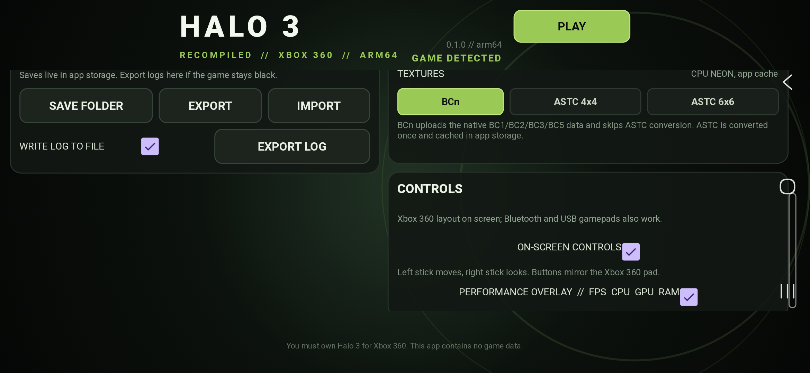
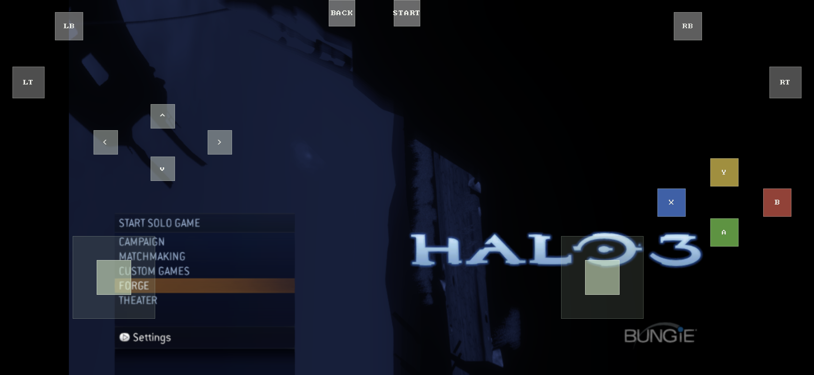
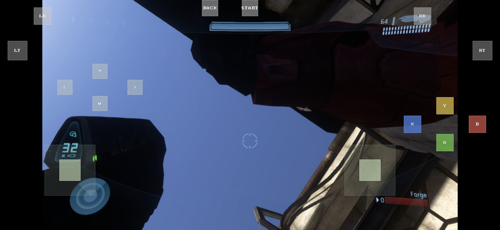

# Galaxy A55 test results

Tested on a Samsung Galaxy A55 (`SM-A556E`, Exynos 1480,
Samsung Xclipse 530 GPU, 8 GB RAM, Android 16) with the arm64 APK built
from this branch.

## What works on the phone

- ISO import into private app storage, including the extracted game data.
- Microsoft / Bungie intro videos.
- Halo 3 main menu with correct geometry and lighting.
- Forge lobby and a loaded Last Resort Forge session, including the HUD,
  weapon, map geometry, skybox and audio.
- On-screen Xbox 360 pad; the left stick, face buttons and menu navigation
  reach the game.
- Save export/import and the in-app diagnostic log export.
- **BCn texture mode** (native BC1/BC2/BC3/BC5 upload, no ASTC conversion).
- Optional **ASTC 4x4 / ASTC 6x6** conversion with a persistent cache.
- The in-game performance overlay (toggleable in the launcher) shows FPS,
  CPU, GPU busy/clock, RAM, target size, GPU fence wait, draws, passes and
  pipeline count.

Screenshots:

## Performance measured

These are from the test build, not targets:

| Scene | Result |
|---|---|
| Main menu | about **1 fps** |
| Intro / logos | about **6–10 fps** |
| Menu with every game draw skipped | about **43 fps** |
| Menu at 320×180 with draws still enabled | about **2.5 fps** |

The menu submits roughly **2,200–2,700 draws across 85–87 render passes**
per frame. The GPU is at 100% and the GPU fence wait is hundreds of
milliseconds. Reducing the render target to 320×180 does **not** restore
the frame rate, so this is not primarily fill-rate limited: it is the
per-draw/per-pass submission and synchronization path.

Getting to 60 fps will require renderer architecture work rather than a
settings change, for example:

- batching or multi-draw/indirect submission for the menu's many draws,
- moving per-draw system constants out of per-draw uniform pushes,
- merging/reducing the EDRAM render passes where the guest allows it,
- and possibly a lower internal render-target path with an upscaling
  resolve.

The A55 port currently boots and renders the game, but 60 fps has not been
achieved.

## Rendering notes

- Packed vertex `vupkd3d128` `SHORT_4` data is decoded as
  `3.0 + signed_short * 2^-22`, matching Xenon's behavior. This fixed the
  stretched and misplaced menu geometry.
- `vpkd3d128` packing types 2/3 are still not implemented; some particle
  effects can be wrong.
- SMAA and FSR are placeholders that use the FXAA path.
- ASTC import-time conversion is not implemented; conversion is first-use
  and cached in app storage.

## Build used

The APK is a release build signed with the local Android debug keystore.
The launcher/game code is generated from the user's own `default.xex`;
no game data is committed to this repository.
